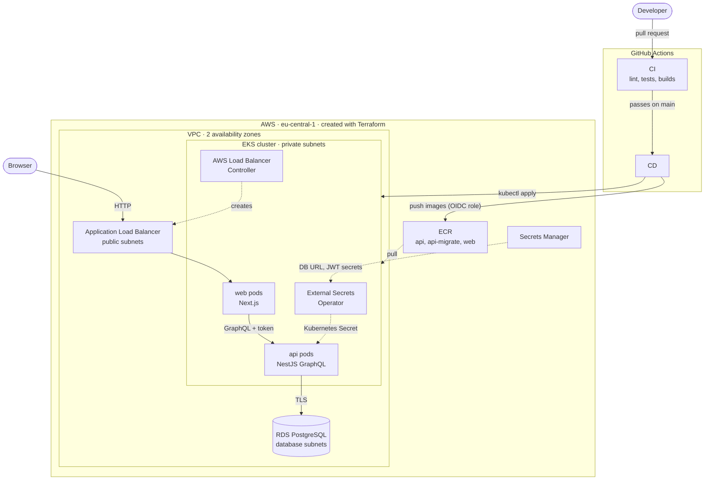

# Job Tracker

Full-stack app for tracking job applications: kanban board, filterable list, notes and a statistics dashboard. Built with Next.js, NestJS, GraphQL, Prisma and PostgreSQL, deployed with Docker and Kubernetes, with AWS infrastructure (EKS, RDS) in Terraform.

| Folder                     | Description                                     |
| -------------------------- | ----------------------------------------------- |
| [`apps/api`](apps/api)     | NestJS GraphQL API ([README](apps/api/README.md)) |
| [`apps/web`](apps/web)     | Next.js frontend ([README](apps/web/README.md))   |
| [`docs`](docs/PROJECT.md)  | Technical overview                              |
| [`infra/k8s`](infra/k8s)   | Kubernetes manifests, Kustomize ([README](infra/k8s/README.md)) |
| [`infra/terraform`](infra/terraform) | AWS infrastructure: VPC, EKS, RDS, ECR ([README](infra/terraform/README.md), [demo runbook](infra/terraform/DEMO.md)) |

## Architecture



- **The browser only talks to Next.js.** Tokens live in httpOnly cookies; the Next.js server attaches them to GraphQL requests and forwards them to the API, which is not exposed outside the cluster.
- **Pods get AWS access through EKS Pod Identity:** the Load Balancer Controller turns the Ingress into the ALB, and External Secrets copies the app's secret from Secrets Manager into the cluster. Database migrations run in an init container of the API pods.
- **No AWS keys in GitHub:** CD assumes an IAM role through OIDC that only trusts `main`. It can push to ECR and deploy to the `job-tracker` namespace, nothing else.
- Locally, [`docker-compose.yml`](docker-compose.yml) runs the same images with PostgreSQL in a container.

## Run the full stack with Docker

```bash
docker compose up --build
```

This starts PostgreSQL, applies migrations, then starts the API (http://localhost:4000/graphql) and the web app (http://localhost:3000). To get the demo account (`demo@jobtracker.dev` / `demo12345`):

```bash
docker compose run --rm migrate npx prisma db seed
```

Optional overrides (JWT secrets, host ports) go in a root `.env` file, see [.example.env](.example.env). The defaults are for local use only.

## Development

Run the database in Docker and the apps with hot reload:

```bash
docker compose up -d db
cd apps/api && npm install && cp .example.env .env && npm run prisma:migrate && npm run dev
cd apps/web && npm install && cp .example.env .env.local && npm run dev
```

See the app READMEs for scripts, environment variables and architecture.

## CI/CD

GitHub Actions in [`.github/workflows`](.github/workflows):

- **CI** runs on pull requests and on `main`: lint, tests (including API e2e tests against PostgreSQL and Playwright browser tests against the Docker stack), builds, Docker images, Terraform checks and Kubernetes manifest validation. Only the jobs for changed folders run; the `ci` job is the one to require in branch protection.
- **CD** deploys `main` to EKS after CI passes. It's off until the AWS environment exists, see [Continuous deployment](infra/terraform/README.md#continuous-deployment).
